# Job Scheduler Flowcharts For VS Code

This version avoids HTML labels like ` `, which some VS Code Mermaid renderers display incorrectly as black squares.

If this still renders badly in your VS Code, open the file in:
- GitHub markdown preview
- Mermaid Live Editor
- Markdown preview in another editor

## 1. Monorepo Structure

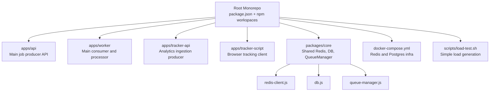

## 2. End-to-End Architecture

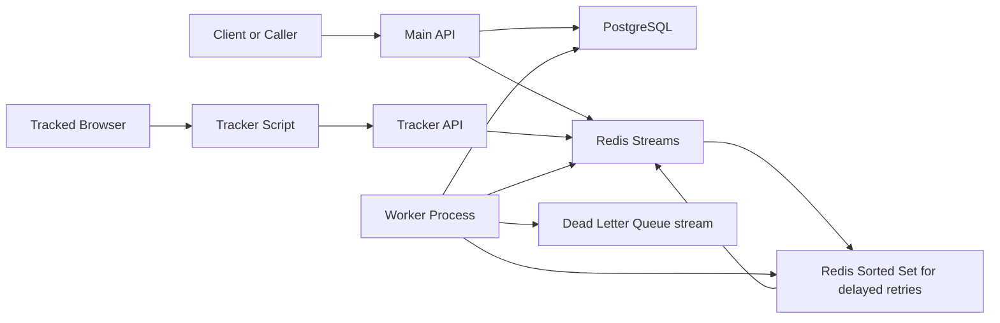

## 3. Main Job Happy Path

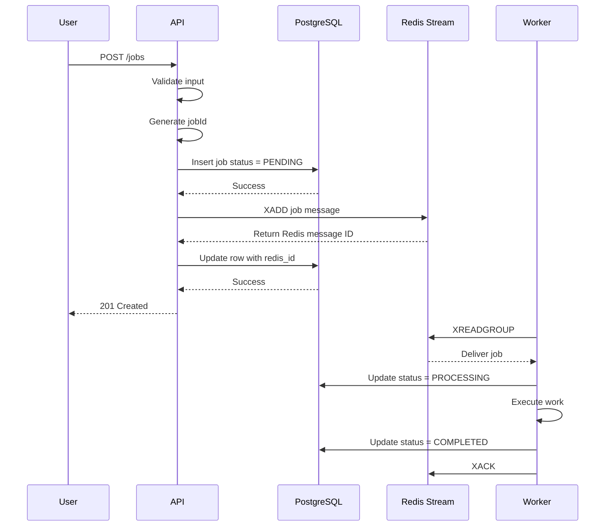

## 4. Main API Decision Flow

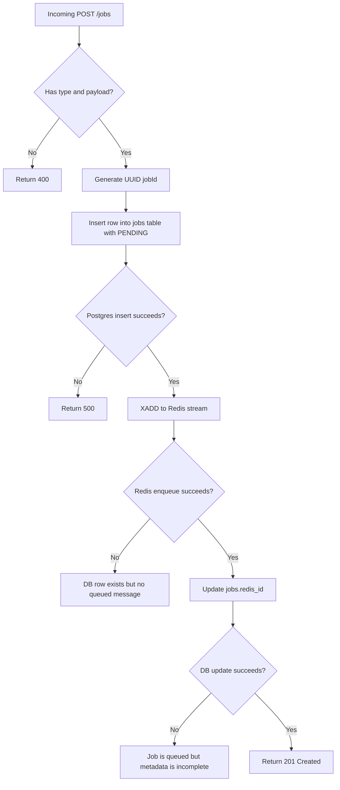

## 5. Worker Consumption Flow

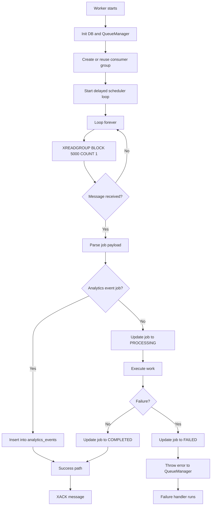

## 6. Retry and DLQ Flow

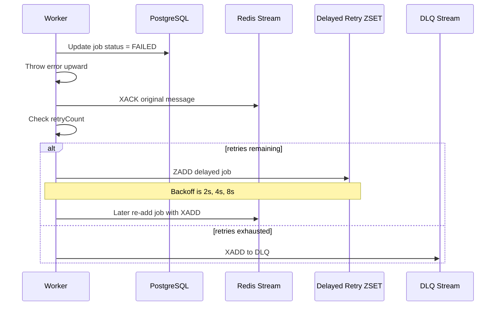

## 7. Delayed Scheduler Internals

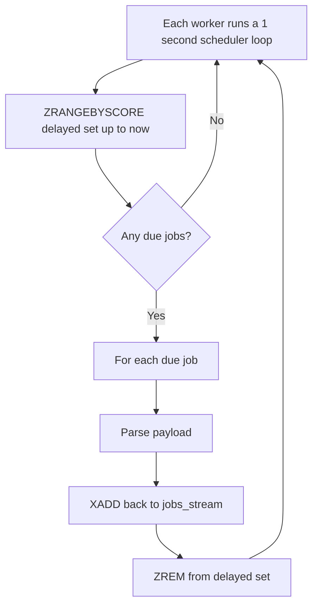

## 8. Job State Machine

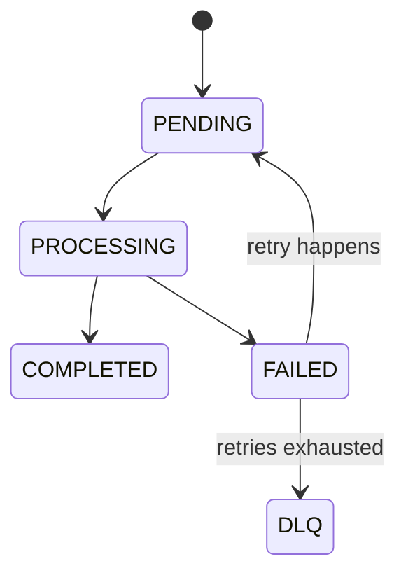

## 9. Tracker and Analytics Flow

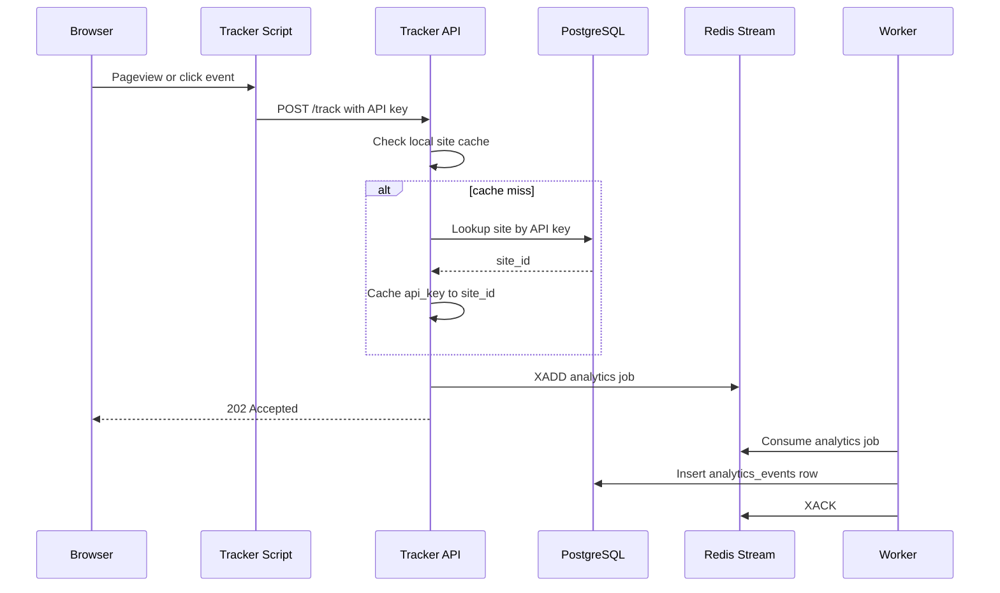

## 10. Runtime Dependency Map

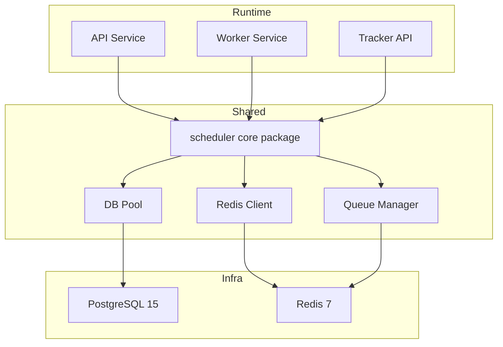

## 11. Data Model

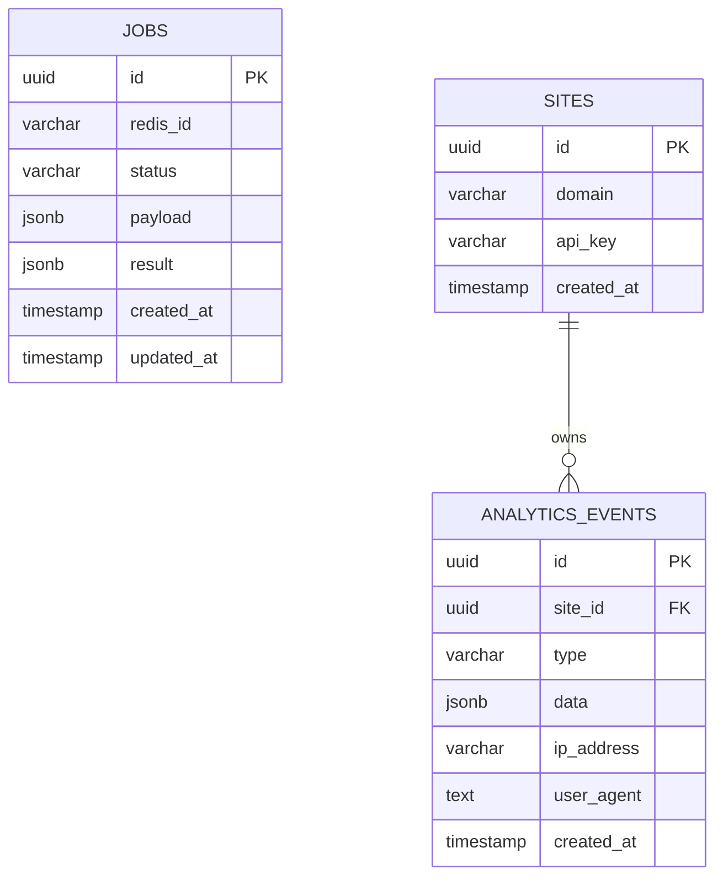

## 12. Bottlenecks By Layer

```mermaid
flowchart TD
    B1["API Layer"] --> B2["Validation is minimal"]
    B1 --> B3["Every request hits Postgres"]
    B1 --> B4["No rate limiting on main API"]

    B5["Queue Layer"] --> B6["COUNT 1 limits throughput"]
    B5 --> B7["No pending message recovery"]
    B5 --> B8["Retry path is not atomic"]
    B5 --> B9["One shared stream for mixed workloads"]

    B10["Worker Layer"] --> B11["Serial processing per worker"]
    B10 --> B12["Many DB updates"]
    B10 --> B13["Demo failure logic only"]

    B14["Storage Layer"] --> B15["Missing useful indexes"]
    B14 --> B16["Analytics writes can grow quickly"]
    B14 --> B17["DB init runs at startup"]

    B18["Operations Layer"] --> B19["No metrics"]
    B18 --> B20["No tracing"]
    B18 --> B21["No DLQ tooling"]
    B18 --> B22["No stuck job recovery"]
```

