# Job Scheduler Interview Flowchart

This document is a senior-level walkthrough of the current project in this workspace. It is intentionally detailed so you can use it as an interview study guide for L3-L6 backend discussions.

Important framing:
- This guide describes the code as it exists now in the workspace, including the tracker components.
- Some parts of the README describe an idealized architecture; this document calls out where the implementation matches that design and where it does not.
- A good interview answer is not "this is perfect." A better answer is "this is what it does today, these are the strengths, and these are the next production-hardening steps."

## 1. Executive Summary

At a high level, this is a distributed asynchronous processing system built with:
- Node.js for application services
- Express for HTTP APIs
- Redis Streams for job queueing
- Redis Sorted Sets for delayed retries
- PostgreSQL for persistent state and queryable history
- Docker Compose for local infrastructure
- npm workspaces for monorepo organization

Core idea:
- A producer accepts a request and enqueues work.
- A worker consumes work asynchronously.
- PostgreSQL holds job status and analytics records.
- Redis holds transient queue state and delayed retry state.

Why this matters in interviews:
- It demonstrates async architecture instead of synchronous CRUD only.
- It shows separation of concerns between ingestion, queueing, processing, and persistence.
- It opens discussion about scaling, failure semantics, consistency, retries, observability, and distributed systems tradeoffs.

## 2. Monorepo Structure

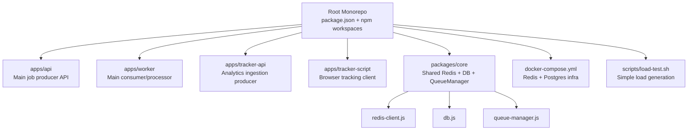

### Why this structure is good

- Shared code lives in `packages/core`, so multiple services reuse the same queue and DB logic.
- Independent services live in `apps/*`, which is a clean monorepo pattern.
- This structure makes it easier to split into separate deployable services later.

### Tradeoffs

- Shared package changes can affect multiple apps at once.
- Without versioning discipline, internal APIs in `packages/core` can drift.
- Monorepos are great for consistency, but CI can get slower as the repo grows.

### Alternatives

- Separate repos for each service: better isolation, worse coordination.
- A modular monolith: simpler initially, but weaker service boundaries.
- TypeScript monorepo with stricter contracts: better safety, more setup overhead.

## 3. End-to-End System Architecture

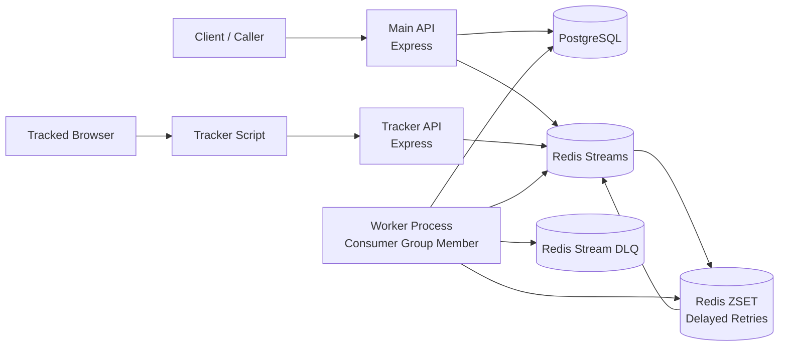

### What each component is responsible for

- `apps/api`: accepts new jobs, writes initial DB record, pushes message to Redis stream.
- `apps/worker`: consumes jobs, executes work, updates DB status, handles failure and retry.
- `apps/tracker-api`: accepts analytics events and uses the same queueing infrastructure.
- `apps/tracker-script`: browser-side client that sends tracking events.
- `packages/core/db.js`: shared Postgres pool and schema bootstrap.
- `packages/core/queue-manager.js`: queue abstraction around Redis Streams and delayed retries.

### Senior-level talking point

This architecture separates:
- control plane style actions: accepting requests, validating input, exposing job state
- data plane style actions: processing work asynchronously at worker speed

That separation is the main performance and resilience win.

## 4. Happy Path: Main Job Submission and Processing

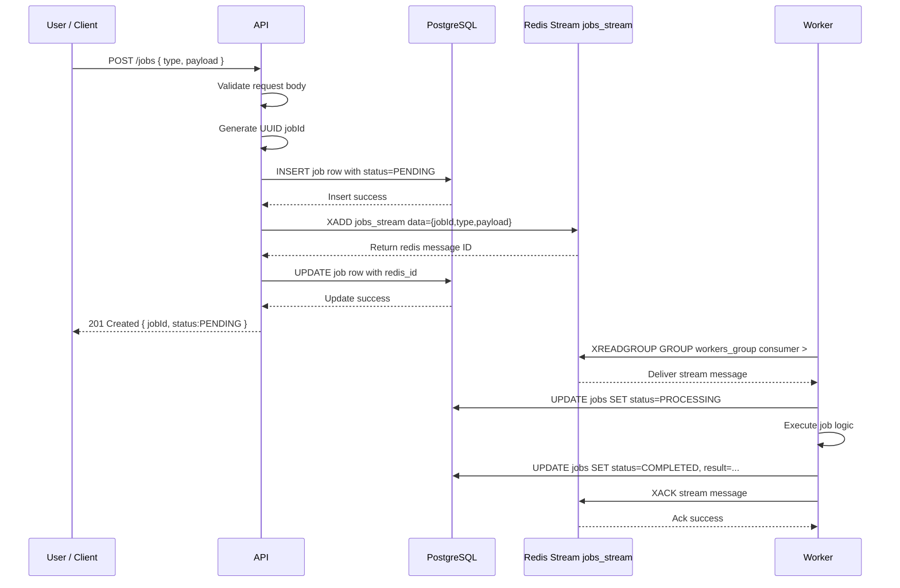

### Why this flow is strong

- The API responds quickly because it does not do heavy work inline.
- Postgres gives durable business visibility into job state.
- Redis Streams gives a queue with persistence and consumer-group semantics.
- Workers can scale independently of API traffic.

### Why these technologies were chosen

#### Node.js

- Good fit for API orchestration and I/O-heavy services.
- Fast to build with for backend workflows.
- Large ecosystem and low ceremony for portfolio and startup-style systems.

Tradeoffs:
- CPU-heavy jobs are a poor fit unless offloaded.
- Runtime correctness is weaker than strongly typed languages if using plain JavaScript.

Alternatives:
- Go for stronger concurrency model and lower memory overhead.
- Java/Kotlin for stronger typing and mature enterprise patterns.
- TypeScript on Node for better safety without leaving the ecosystem.

#### Express

- Minimal, familiar, fast to set up.
- Good for small services and simple middleware pipelines.

Tradeoffs:
- Very unopinionated, so architecture quality depends on the team.
- Less built-in structure than NestJS or Fastify ecosystems.

Alternatives:
- Fastify for higher performance and schema-first validation.
- NestJS for enterprise structure and DI.

#### PostgreSQL

- Strong durability and queryability.
- Great for job state lookup and analytics storage.
- ACID semantics help keep business records trustworthy.

Tradeoffs:
- Not ideal as the queue itself for high-throughput async dispatch.
- Can become a write bottleneck if every worker update is extremely frequent.

Alternatives:
- MySQL is workable but generally weaker for JSON-heavy and operational flexibility.
- Cassandra or ClickHouse for very high-scale analytics, but more complex.

#### Redis Streams

- Good middle ground between a simple list queue and a full broker.
- Supports consumer groups and message persistence.
- Operationally simpler than Kafka for a project at this size.

Tradeoffs:
- Fewer built-in guarantees and operational tools than Kafka.
- Requires care around pending entries, retries, and ack timing.

Alternatives:
- RabbitMQ for classic work queues and ack/requeue patterns.
- Kafka for very high-scale event streaming and replay.
- SQS for managed cloud simplicity.

## 5. Detailed Decision Flow: Main API

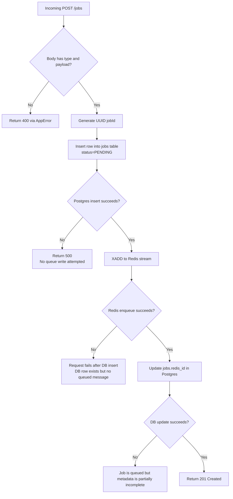

### Positives at each checkpoint

#### Validation

- Rejecting bad requests early protects downstream systems.
- Prevents garbage work from entering the queue.

#### Generate `jobId` in API

- Stable application-level ID exists before queue insertion.
- Makes later correlation between DB, logs, and queue easier.

#### Write to Postgres before Redis

- Preserves a durable record before handing work to async infrastructure.
- This resembles a simplified outbox-inspired approach.

#### Queue after DB insert

- Lets the API expose status immediately after enqueue.
- Worker can remain stateless with respect to request origin.

### Bottlenecks

- Every request does two Postgres writes and one Redis write.
- Under high load, Postgres write amplification may be the first scaling limit.
- If Redis is healthy but Postgres is slow, the API still slows down because DB is in the request path.

### Tradeoffs

- Current ordering favors durable metadata before queueing, but it is not truly atomic.
- If DB insert succeeds and Redis enqueue fails, the system has a stranded `PENDING` row.
- If Redis enqueue succeeds and DB update of `redis_id` fails, the job still runs but metadata is incomplete.

### Senior interview improvement

To make this stronger, discuss:
- transactional outbox table in Postgres
- background dispatcher moving outbox rows to Redis
- idempotent enqueueing / dedupe keys
- reconciliation job for orphaned DB rows

## 6. Worker Consumption Flow

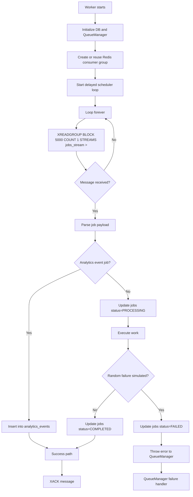

### Why consumer groups matter

- Multiple workers can share the same stream.
- A new message is delivered to one consumer in the group, not all consumers.
- This is how horizontal scaling is achieved.

### Positives

- Worker throughput can scale independently by starting more worker instances.
- Blocking reads avoid wasteful polling loops.
- Database status updates make job progress externally visible.

### Bottlenecks

- Current worker reads `COUNT 1`, so throughput per worker may be modest.
- The worker processes jobs serially within each process.
- A fixed 2-second simulated job time means backlog grows fast under heavy input.
- Every processed job writes to Postgres, which can become a bottleneck before Redis does.

### Tradeoffs

- Serial processing is simpler and safer but slower.
- Larger batch reads improve throughput but complicate fairness and failure handling.
- More worker processes improve throughput but also increase DB contention and retry races.

### Alternatives

- Increase concurrency inside each worker process with a bounded promise pool.
- Use separate queues per job type to isolate slow and fast work.
- Use dedicated workers for analytics vs general jobs.

## 7. Failure, Retry, and DLQ Flow

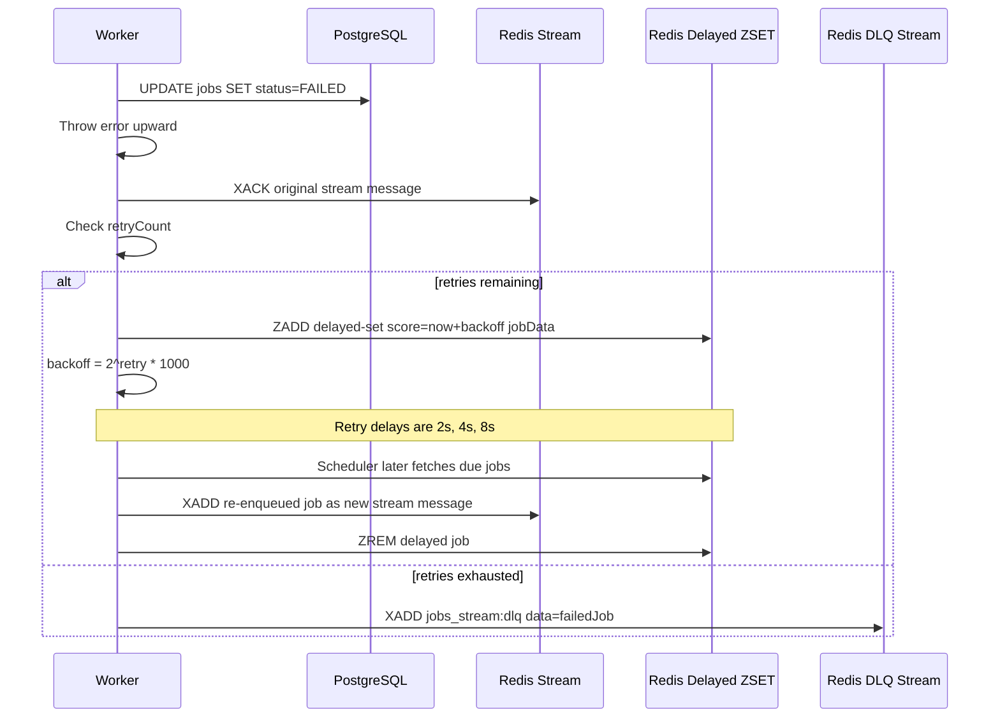

### What is good here

- Retry with backoff avoids instant retry storms.
- DLQ prevents poison messages from retrying forever.
- Retry state lives in payload, so re-enqueued messages carry their history.

### Important implementation caveat

This system acks the original message before the retry message is durably re-added to the main stream.

That creates a failure window:
- if the process crashes after `XACK`
- and before `ZADD`
- the message can be lost

For an interview, say this clearly:

> “The design aims for at-least-once semantics, but the current retry path is not fully crash-safe because ack and retry scheduling are not atomic.”

### Bottlenecks

- Delayed retry scheduler scans due jobs every second.
- Each worker starts its own scheduler loop.
- Multiple workers can contend on the same delayed set.
- Re-enqueueing one job at a time can become expensive at scale.

### Tradeoffs

- Simplicity: easy to implement with Redis ZSET.
- Cost: weaker guarantees and potential duplicate or raced scheduling behavior.

### Better production alternatives

- Dedicated scheduler service owning the delayed set.
- Lua scripts for more atomic Redis state transitions.
- RabbitMQ delayed exchange or dead-letter retry topology.
- Kafka plus retry topics with scheduled consumers.
- SQS visibility timeout plus DLQ configuration.

## 8. Delayed Scheduler Internals

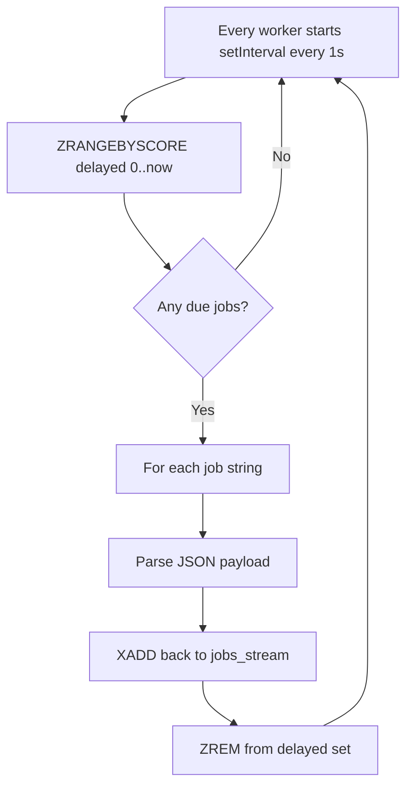

### Positive

- Very understandable design.
- Works well enough for small systems and demos.
- Easy to explain in interviews.

### Risks

- If multiple workers run this loop, they may all fetch the same due jobs before removal.
- Ordering is not guaranteed across re-enqueued delayed jobs.
- Crash between `XADD` and `ZREM` can lead to duplicates.
- Large delayed sets can make periodic scans more expensive.

### Senior-level improvement ideas

- Use a single scheduler leader election mechanism.
- Use Redis Lua to atomically claim and move due jobs.
- Store retry jobs as structured hashes rather than raw JSON strings.
- Introduce jitter to backoff to reduce synchronized retry bursts.

## 9. Job State Machine

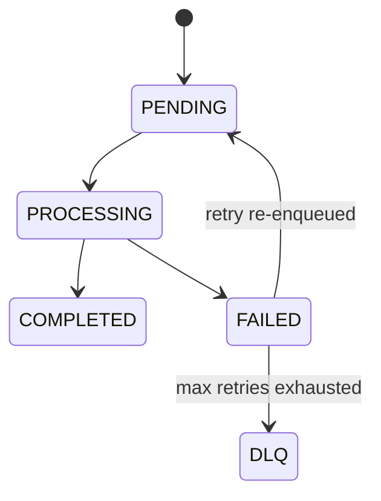

### Important nuance

This is the logical state machine, but the implementation has a semantic mismatch:
- the worker writes `FAILED` on each failure attempt
- even when the job is still eligible for retry

For senior interviews, call out that a richer state model would be better:
- `PENDING`
- `PROCESSING`
- `RETRY_SCHEDULED`
- `COMPLETED`
- `PERMANENT_FAILURE`
- possibly `CANCELLED`

### Why that matters

- Better operator visibility
- Better dashboards
- Less confusion for API consumers
- Easier incident debugging

## 10. Tracker / Analytics Flow

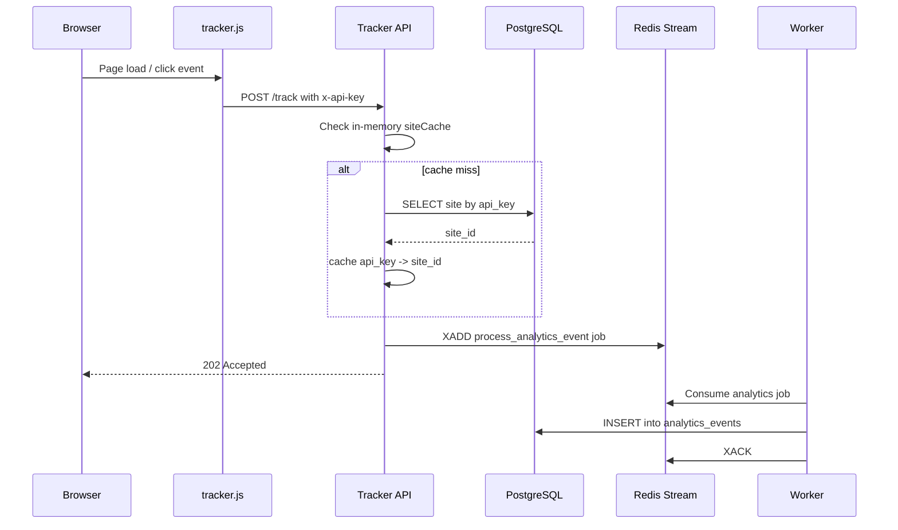

### Why this is a strong extension of the project

- It proves the queue is reusable for more than one workload.
- It shows the system can support event ingestion, not only explicit job scheduling.
- It demonstrates API-key authentication, lightweight caching, and asynchronous analytics writes.

### Positives

- Tracker API is kept fast by queueing the DB-heavy event write.
- Browser script is minimal and easy to embed.
- In-memory cache reduces repeated DB lookups for valid API keys.

### Bottlenecks

- `siteCache` is per-process memory only, so it does not scale across many instances.
- Tracker API still depends on DB for cache misses.
- Analytics jobs share the same queue as general jobs, so noisy traffic can starve other workloads.

### Tradeoffs

- One shared queue is simple, but mixing workloads can create interference.
- Per-process cache is fast, but not distributed or invalidation-friendly.

### Alternatives

- Separate streams by domain: `jobs_stream` and `analytics_stream`.
- Redis cache for API keys instead of local `Map`.
- Batch analytics inserts in the worker for better throughput.

## 11. Infra and Runtime Dependencies

```mermaid
flowchart TB
    subgraph Runtime
        A[API Service]
        B[Worker Service]
        C[Tracker API]
    end

    subgraph SharedPackage
        D[@scheduler/core]
        D1[DB Pool]
        D2[Redis Client]
        D3[Queue Manager]
    end

    subgraph Infra
        E[(PostgreSQL 15)]
        F[(Redis 7)]
    end

    A --> D
    B --> D
    C --> D

    D --> D1
    D --> D2
    D --> D3

    D1 --> E
    D2 --> F
    D3 --> F
```

### Why Docker Compose is used

- Makes local setup reproducible.
- Gives isolated infra without requiring local Redis or Postgres installs.
- Great for demos, onboarding, and portfolio projects.

### Tradeoffs

- Good for local development, not a production deployment model.
- No service health checks or orchestration-level restart policy defined here.

### Production alternatives

- Kubernetes with managed Redis/Postgres
- ECS/Fargate with ElastiCache and RDS
- Nomad or Docker Swarm for simpler orchestration

## 12. Data Model Walkthrough

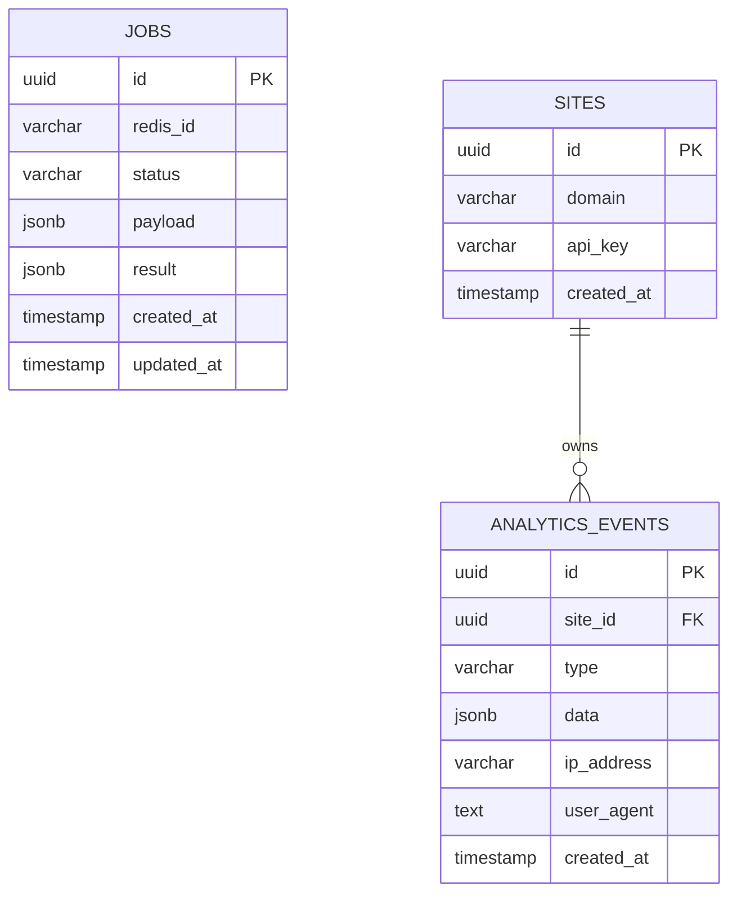

### Why the schema is useful

- `jobs` gives observable async state for external clients.
- `sites` allows API-key-based tenant mapping.
- `analytics_events` stores raw event data flexibly with `JSONB`.

### Tradeoffs

- `JSONB` is flexible but weakly structured.
- No explicit indexes besides PK and unique `api_key`.
- Query performance on status or event type may degrade as data grows.

### Production improvements

- Index `jobs(status, created_at)`
- Index `analytics_events(site_id, created_at)`
- Partition analytics tables by date
- Add retention policies and archival

## 13. Current Bottlenecks by Layer

```mermaid
flowchart TD
    B1[API Layer] --> B2[Validation is minimal]
    B1 --> B3[Every request hits Postgres]
    B1 --> B4[No rate limiting / auth on main API]

    B5[Queue Layer] --> B6[COUNT 1 limits throughput]
    B5 --> B7[Pending-message recovery not implemented]
    B5 --> B8[Retry path not atomic]
    B5 --> B9[One shared stream for mixed workloads]

    B10[Worker Layer] --> B11[Serial processing per worker]
    B10 --> B12[Per-job DB updates increase write load]
    B10 --> B13[Random failure simulation is only demo logic]

    B14[Storage Layer] --> B15[No indexes for common query patterns]
    B14 --> B16[Analytics writes can grow quickly]
    B14 --> B17[Init DB runs in app startup path]

    B18[Operations Layer] --> B19[No metrics]
    B18 --> B20[No tracing]
    B18 --> B21[No dead-letter inspection tooling]
    B18 --> B22[No stuck-job recovery loop]
```

## 14. Checkpoint-by-Checkpoint Positives, Tradeoffs, Alternatives

### Checkpoint: API receives request

Positive:
- clean separation between sync request and async execution

Tradeoff:
- user gets acceptance, not completion

Alternative:
- synchronous processing for short jobs only

When to prefer current design:
- heavy jobs
- bursty load
- latency-sensitive APIs

### Checkpoint: Persist job before enqueue

Positive:
- durable business record first

Tradeoff:
- not fully atomic with enqueue

Alternative:
- transactional outbox

When to prefer current design:
- smaller systems where operational simplicity matters more than perfect delivery semantics

### Checkpoint: Redis Streams as queue

Positive:
- consumer groups and persistence in one tool

Tradeoff:
- more manual delivery semantics than managed queues

Alternative:
- RabbitMQ for work queue semantics
- Kafka for event log / replay
- SQS for managed cloud queue

When to prefer current design:
- moderate scale, self-hosted stack, low operational overhead target

### Checkpoint: Worker updates Postgres status

Positive:
- job progress is queryable via API

Tradeoff:
- more writes per job

Alternative:
- state only in Redis for speed
- write only terminal states to DB

When to prefer current design:
- user-facing job tracking matters

### Checkpoint: Retry through delayed set

Positive:
- easy backoff behavior

Tradeoff:
- extra moving parts and weak atomicity

Alternative:
- queue-native retry support
- dedicated scheduler service

When to prefer current design:
- portfolio projects, prototypes, small systems

### Checkpoint: Same worker handles analytics and general jobs

Positive:
- code reuse and low deployment complexity

Tradeoff:
- resource contention between workloads

Alternative:
- separate streams and separate worker pools

When to prefer current design:
- low scale, early stage, simple ops

## 15. Reliability Model: What You Should Say in Interviews

### What the system does well

- Durable job metadata in Postgres
- Persistent queue with Redis Streams
- Retry with bounded attempts
- DLQ isolation for repeated failures
- Horizontal scaling through consumer groups

### What is not fully solved yet

- No recovery of pending messages from dead consumers
- Retry transition is not atomic
- Delayed scheduler ownership is not centralized
- No idempotency enforcement in worker side-effects
- No exactly-once guarantee

### Strong answer

> “This system is best described as an async job processor with partial at-least-once intent, but not fully hardened at-least-once semantics yet. To make that claim confidently in production, I’d add pending-entry recovery, atomic retry transitions, stronger idempotency, and better operational observability.”

## 16. Scaling Story From L3 to L6

### L3 answer

- API writes to DB and Redis
- worker reads from Redis and updates DB
- failures are retried with backoff
- jobs eventually go to DLQ

### L4 answer

- explain consumer groups
- explain decoupling between ingestion and execution
- explain DB as source of queryable truth
- explain operational risks like duplicate processing and orphaned rows

### L5 answer

- discuss consistency boundaries between Postgres and Redis
- describe why a transactional outbox is safer
- describe retry storms, noisy-neighbor issues, and idempotency needs
- discuss separate worker pools and queue partitioning by workload

### L6 answer

- discuss failure domains and ownership boundaries
- describe how to evolve this into a production architecture
- add metrics, tracing, replay tooling, tenancy isolation, backpressure policies, and recovery workflows
- discuss cost vs correctness tradeoffs rather than only technical ideals

## 17. Production Hardening Roadmap

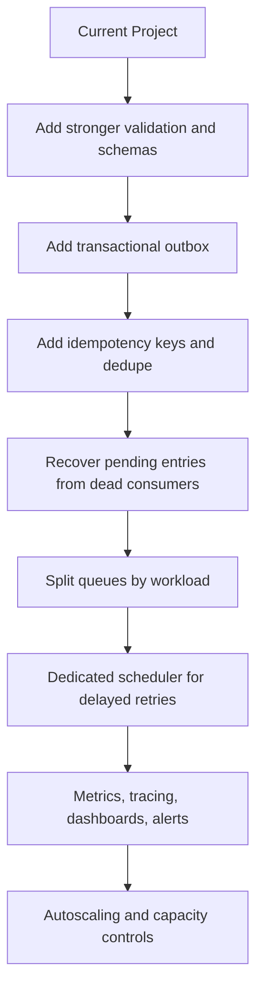

### Best next improvements to mention

1. Transactional outbox to remove DB/Redis inconsistency window.
2. Pending entry recovery using `XPENDING` and `XCLAIM` or `XAUTOCLAIM`.
3. Separate streams for analytics and general jobs.
4. Worker concurrency controls and backpressure limits.
5. Metrics for queue depth, retry rate, processing latency, and DLQ growth.

## 18. Interview Q&A Cheat Sheet

### Why not process the job directly in the API?

- It would make request latency equal to job latency.
- Failures would be client-facing instead of asynchronously recoverable.
- API instances would be tied to compute-heavy work.

### Why both Postgres and Redis?

- Redis is used for fast queueing and worker coordination.
- Postgres is used for durable, queryable business state.
- They serve different access patterns.

### Why not use Postgres as the queue too?

- You can, but queue semantics and high-throughput consumption are usually better handled by a dedicated queue/broker.
- Using Postgres for both can increase lock contention and operational coupling.

### What happens if the worker crashes mid-job?

- In the current implementation, recovery of pending stream entries is not implemented.
- So some claimed-but-unacked jobs may remain pending and need a recovery strategy.

### Is this exactly once?

- No.
- The safer claim is async processing with retries and possible duplicates.
- Side effects should be idempotent.

### What is the biggest correctness risk?

- The gap between acking a failed message and durably scheduling its retry.

### What is the biggest scale risk?

- Mixed workloads sharing one queue and Postgres becoming the write bottleneck.

## 19. Final Senior-Level Summary

Use this as a closing explanation:

> “This project is a Node.js async job platform built around Redis Streams and PostgreSQL. The API persists job metadata, enqueues work, and returns immediately. Workers consume from a Redis consumer group, update job state in Postgres, and implement retries with exponential backoff using a Redis sorted set. There is also an analytics ingestion path that reuses the same queueing infrastructure, which shows the design is extensible. The current system is strong as a portfolio architecture because it demonstrates service boundaries, async processing, retries, DLQ handling, and horizontal scaling concepts. The main next-step improvements for production would be atomic outbox-style enqueueing, pending-message recovery, workload isolation, stronger idempotency, and observability.”

